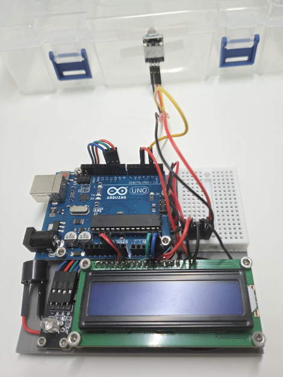
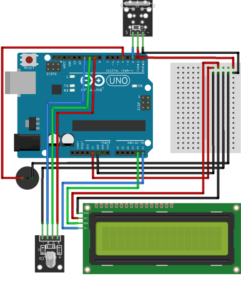
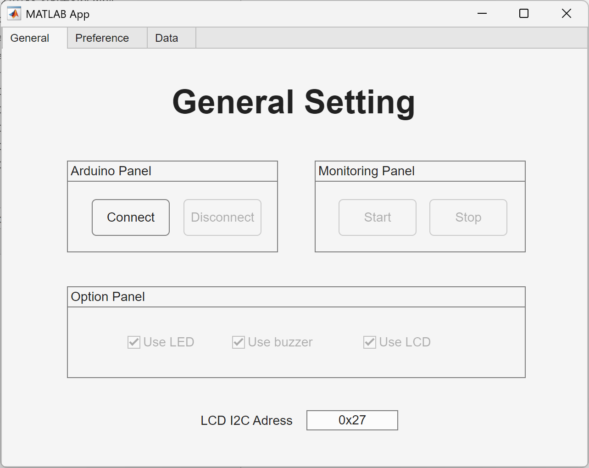
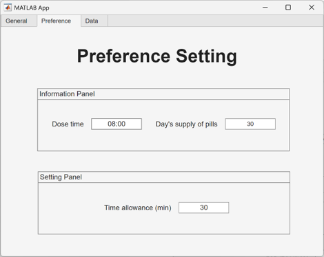
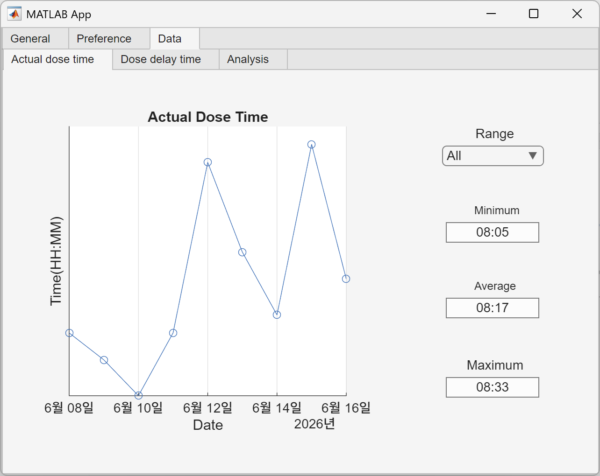
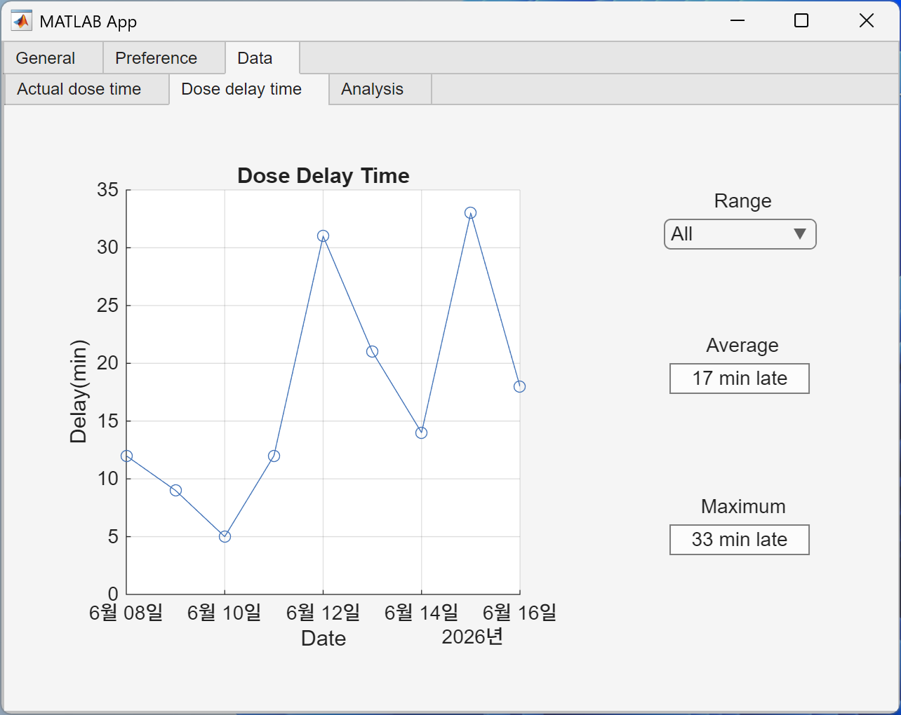
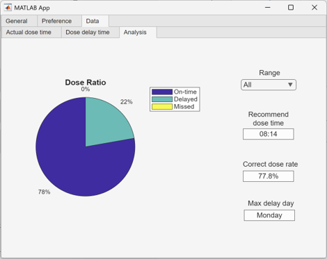
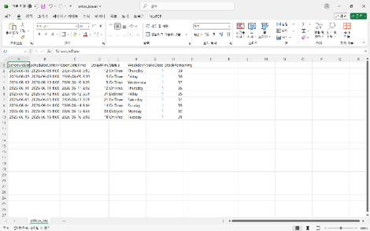

## 1. 프로젝트 개요
이 프로젝트는 아두이노와 MATLAB App Designer를 활용하여 약 복용 시간을 알리고, 약 보관함의 개폐 여부를 감지하여 복용 시각과 여부를 엑셀에 자동으로 기록하며, 기록 시각화, 잔여 약 분량 경고, 복용 시간 추천 등의 기능을 제공하는 스마트 약 복용 관리 장치를 구현합니다.

이 프로젝트는 2026년, 대학교 2학년 시기, 전자공학SW실험Ⅰ 수업의 일환으로 개발되었습니다.

## 2. 프로젝트 사진
### 프로토타입

### 회로도

### MATLAB 앱 GUI

## 3. 주요 특징
- 약 복용 시점 기록
  약 보관함의 개폐 여부를 감지하여 복용 시각과 날짜를 CSV 파일에 기록한다.
- 기록 시각화
  저장한 기록을 기반으로 실제 복용 시각, 복용 지연 시간, 복용률을 요일별 그래프로 시각화한다.
- 기록 분석
  각 그래프에서 최소·평균·최대 복용 지연 시간, 비율 등을 계산하고, 절사평균을 이용해 복용 시간을 추천한다.
- 단계별 복용 알림
  예정 약 복용 시간이 지나도 약 보관함의 개폐가 감지되지 않을 경우, 시간 경과에 따라 단계적으로 이를 알린다.
    1) 10분 경과 시: LED 천천히 점멸
    2) 30분 경과 시: LED 빠르게 점멸
    3) 1시간 경과 시: LED 점등 및 부저 작동
    4) 하루 종료 시: 미복용 처리
- 잔여 약 분량 추정 및 표시
  약 보관함의 개폐 횟수를 복용 횟수로 간주하여 남은 약 분량을 추정하고, 그에 따라 단계적으로 이를 알린다.
    1) 3회 분량 이하: 노란색 LED 점등
    2) 1회 분량 이하: 빨간색 LED 점등
    3) 0회 분량: 빨간색 LED 빠른 점멸
